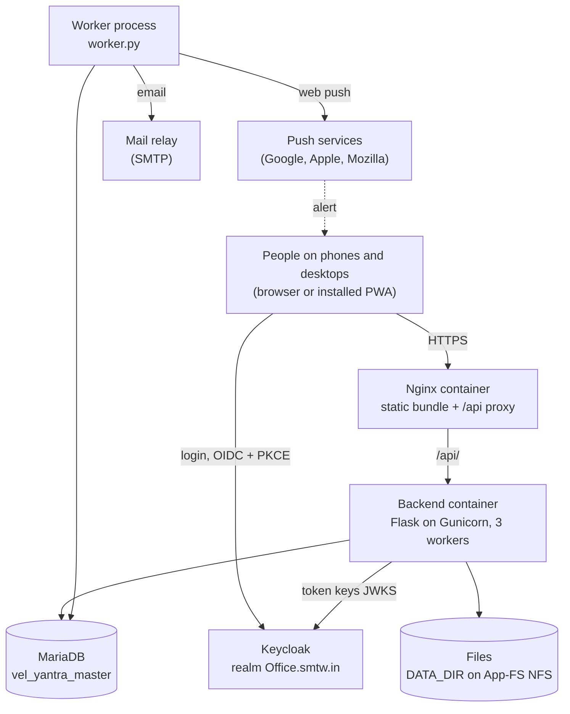
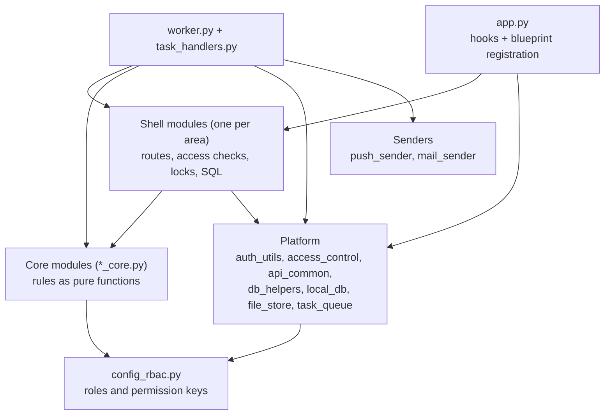
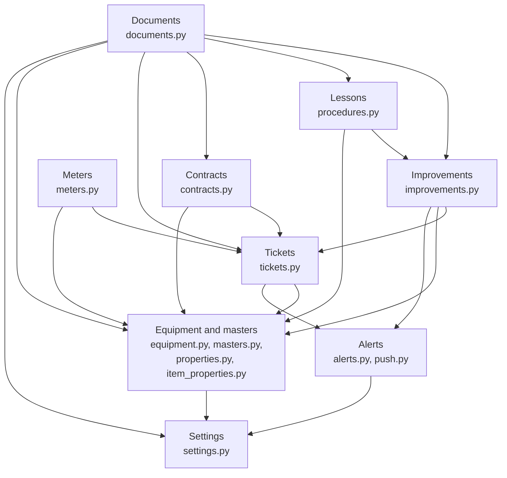
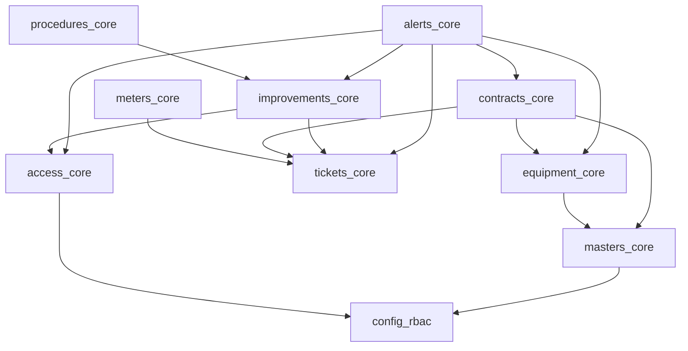
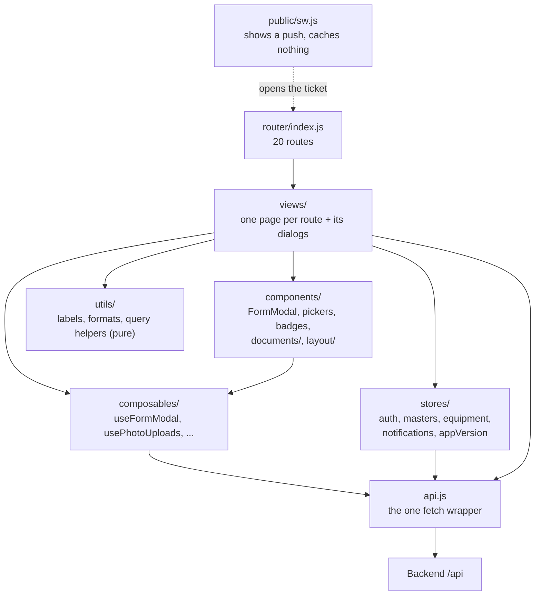
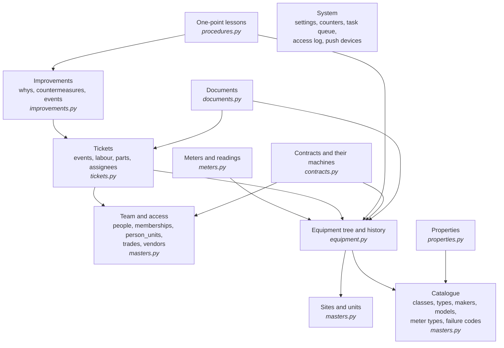
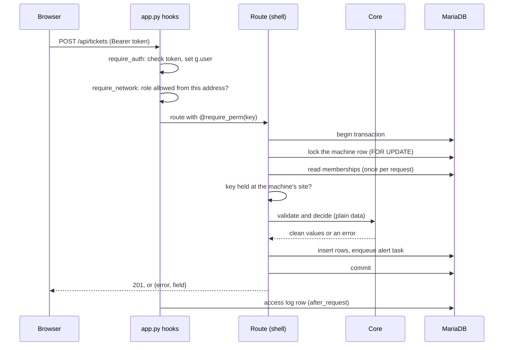
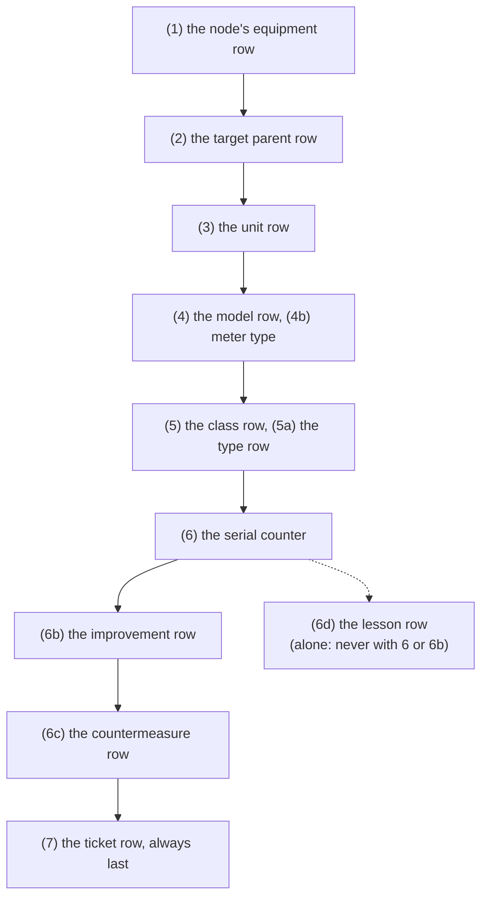
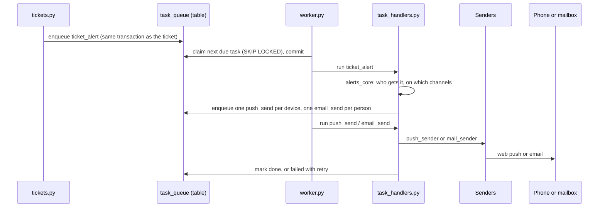

# Yantra — Architecture

Status: Agreed, 11-11-2026

Yantra is a maintenance app (CMMS) for the plants: one Flask backend, one Vue frontend, one
MariaDB database and one background worker. This doc says how the code is built today, and why.

**How to read it.** Each section has a small diagram and a few lines below it. An arrow in a
module diagram points from the module that depends to the module it depends on. Evidence is a
path or `file:line` in brackets. The doc does not repeat `.claude/SMTW-WebApp-Base.md` (the
*base*): it names the base section a pattern follows. Tables and columns are not drawn here: open
[`docs/schema.html`](schema.html), which is generated from the migrations. Places where the code
departs from its own rules are in § 8 *Known drift*, not in the sections that describe the design.

Only the `architect` agent edits this file (`docs/steps/README.md` § The architecture doc).

---

## 2. Context

**Diagram 1: the system and what it talks to**

A user signs in at Keycloak and the browser sends the token with every API call. Nginx serves the
built frontend and passes `/api/` to the backend (`tooling/build/nginx.conf:23-47`). The backend
and the worker are two processes over the same code and the same database; only the worker talks
to the push services and the mail relay (`backend/push_sender.py`, `backend/mail_sender.py`).

- **Users and roles**: operators, technicians, supervisors, storekeepers, engineers, managers, IT
  admin (`backend/config_rbac.py:26-34`); the product plan is `docs/Plan.MD` § 3.
- **Backend**: `backend/app.py` registers 12 blueprints (`app.py:171-213`); Gunicorn runs 3
  workers on port 5000 (`tooling/build/gunicorn.conf.py:3-4`).
- **Worker**: `python worker.py`, one at a time per database (`backend/worker.py:1-20`). The
  production compose file lives in the devops repo (`tooling/build/example-docker-compose.yml:1-9`),
  so how the worker's container is declared there is *to verify*.
- **Files**: on disk under `DATA_DIR`, never served as static files (`backend/file_store.py:25-32`).
- **Planned, not built**: OneERP warehouse sync, Telegram (S023, parked), plant-3i, aibots,
  VelKilnMaster and Vaahan feeds (`docs/Plan.MD` § 7).

---

## 3. Module map

### 3.1 The layers of the backend

**Diagram 2: four layers, dependencies point down**

Each area has a **shell** (`tickets.py`) and a **core** (`tickets_core.py`). The core holds the
rules as plain functions: no database, no Flask, no clock. I checked all 18 `*_core.py` files: none
imports Flask, PyMySQL or a shell module, and none calls `datetime.now()` (grep of
`backend/*_core.py` imports, 11-11-2026). The shell fetches the inputs, takes the locks, calls the
core and stores the result (`backend/equipment.py:5-7` states it). This is CLAUDE-COMMON's *Pure
core, thin shell*. `config_rbac.py` imports nothing and everything may read it.

**SQL text in a core** (agreed by the user, 11-11-2026; decision 22). A pure core may build SQL
text. It never runs it. It may do so only when all four conditions hold:

1. The rule must run in the database: it filters or aggregates over many rows.
2. Every value goes in as a parameter, and every identifier comes from a fixed list in the code.
3. The table aliases the fragment relies on are named in its docstring, next to the joins they
   come from.
4. At least one database-backed test (an API test) runs each fragment. A test that compares the
   SQL text alone does not count.

Why: the builder stays pure, so its injection test runs without a database
(`backend/tests/test_property_filter_core.py:224`), and `contracts_core.LINE_SITE_JOINS` stays one
copy shared by `contracts.py` and `alerts.py` (`backend/contracts_core.py:325-334`). The cost is
that the core depends on the shell's aliases; conditions 3 and 4 contain it. Two alternatives were
rejected. Separate pure `*_sql.py` query modules would add a fourth layer for two uses; revisit
this when PM or KPI reports add more query builders. Moving the fragments to the shells would make
`alerts.py` import `contracts.py` or copy the joins, and would put the injection test behind a
database. Today's builders: `contracts_core.covered_sql`, `LINE_SITE_JOINS`, `LINE_SITES_SQL`
(`contracts_core.py:314-338`) and `property_filter_core.filter_condition`
(`backend/property_filter_core.py:200-262`).

The worker runs the same shells' functions without Flask's request (`backend/task_handlers.py:28-45`).

### 3.2 The areas and how they depend on each other

**Diagram 3: the area shells (an arrow is an import of the other shell's functions)**

Equipment is the base: every other area finds its machine and its site through
`equipment.load_node_for_user` and `unit_access_condition` (`backend/equipment.py:378-398`).
Tickets sit on equipment; improvements, contracts and meters read tickets; documents sit on top
and know every owner. There is no import cycle between shells (import graph of `backend/*.py`,
11-11-2026). Alerts also read the *cores* of tickets, improvements and contracts for the alert
rules (`backend/alerts_core.py:19-24`), which is not drawn.

**The rule** (agreed by the user, 11-11-2026; decision 21): a table is written only by its
area's shell. Another area that needs a row calls the owner's function, it does not write its own
SQL against the table. Examples: `documents.py` reaches a ticket only through
`tickets.read_ticket`, `lock_ticket_for_change` (`backend/documents.py:86-100`, the `OWNERS`
registry at `documents.py:193`); `contracts.py` checks a vendor through
`masters.check_active_vendor` (`backend/contracts.py:122`). The code follows the rule
except at the places of § 8, D1, which a step will fix.

| Area | Shell | Core | Owns |
|---|---|---|---|
| Equipment | `equipment.py` | `equipment_core`, `labels_core`, `asset_list_core` | the register tree, its history, QR labels, the asset list |
| Masters | `masters.py` | `masters_core` | sites, units, classes, types, makers, models, meter types, failure codes, Team, vendors |
| Properties | `properties.py`, `item_properties.py` | `properties_core`, `property_filter_core` | technical data: definitions, class links, model and item values |
| Meters | `meters.py` | `meters_core` | a node's meters and readings |
| Tickets | `tickets.py` | `tickets_core` | breakdowns and defects, their timeline, labour, parts |
| Improvements | `improvements.py` | `improvements_core`, `improvement_register_core` | why-why, root cause, countermeasures, the verified close |
| Lessons | `procedures.py` | `procedures_core` | one-point lessons |
| Contracts | `contracts.py` | `contracts_core` | vendor contracts, their machines, renewals, breakdown calls |
| Documents | `documents.py` | `documents_core` | files of six kinds of owner |
| Alerts | `alerts.py`, `push.py`, `task_handlers.py` | `alerts_core`, `push_core`, `email_core` | who gets which alert, devices, sending |
| Settings and access | `settings.py`, `access_control.py`, `auth_utils.py` | `access_core`, `network_core` | settings, the network gate, the access log, permissions |

### 3.3 How the cores depend on each other

**Diagram 4: the main core modules**

`tickets_core` and `masters_core` are at the bottom, and import no other core. Part of that is the
domain (an improvement is about tickets). Part of it is where shared helpers happen to live: see
§ 8, D4.

### 3.4 The frontend

**Diagram 5: the frontend's areas**

The frontend is thin: the rules stay in the backend and `utils/` only names and formats values
(`frontend/src/utils/ticketLabels.js:1-4`, `contractLabels.js:1-6` say so). Each page lives in
`views/`, with its dialogs in a folder of the same area (`views/tickets/`, `views/contracts/`).
Every call goes through `api.js` (`frontend/src/api.js:84-108`). The permission list comes from
`/api/auth/me` into the auth store (`frontend/src/stores/auth.js:77-94`); the router has no
permission guard on purpose: the API's 403 or 404 is the gate and buttons are hidden by permission
(`frontend/src/router/index.js:26`, `:56`). The service worker handles only `push` and
`notificationclick` (`frontend/public/sw.js:18`, `:44`). Layout and form patterns: base § Frontend
Design, § Frontend API Helper Pattern.

---

## 4. Data areas

**Diagram 6: the groups of tables, the module that writes each, and how they link**

An arrow is a foreign key from the group to the group it points at. Read it top-down as "who
needs whom": tickets need a machine and people; an improvement needs tickets; a lesson comes from
a countermeasure or stands on a machine or a class; a contract has a vendor and machines.
Documents is one table, `equipment_documents`, with one owner column per kind of owner (node,
model, ticket, countermeasure, lesson, contract; `backend/documents.py:193-222`); only four of its
links are drawn. The System tables have no foreign keys (`docs/schema/notes.json`, area *System*).

The four areas of the schema page (Equipment, Team and access, Tickets, System) and what each
table holds are in `docs/schema/notes.json`. The columns, keys and indexes are on
[`docs/schema.html`](schema.html).

**Who writes what** (grep of `INSERT`, `UPDATE`, `DELETE` per module, 11-11-2026; generic writes go
through `db_helpers.insert_row` / `update_row`, `backend/db_helpers.py:57-75`):

- A group is written by the module named in its box.
- `serial_counters` is written only by `db_helpers.next_counter` (`db_helpers.py:78`), which every
  serial uses (tickets, improvements, lessons, equipment codes). Base § Serial Number Generation.
- `equipment_events` (a machine's history) is written through `equipment.write_events`
  (`equipment.py:516`), also by meters, properties and contracts, which import it.
- `people.email` is written at login by `auth_utils.store_login_email` (`auth_utils.py:327`).
- Stated exceptions, where a module writes another's table, are in § 8, D1.

**Planned groups** (not built): PM templates, plans, jobs and results; procedure items and
completions (`docs/schema/notes.json`, `planned`; `docs/Plan.MD` § 4.3).

---

## 5. Cross-cutting patterns

### 5.1 A request: sign-in, network gate, permission, site

**Diagram 7: one write request, from the browser to the answer**

Four checks, in this order:

1. **Sign-in** — `auth_utils.require_auth` validates the Keycloak token and fills `g.user`
   (`backend/auth_utils.py:255`; registered at `app.py:52-55`). Base § Keycloak Token Validation
   Pattern. Three paths are public (`auth_utils.py:230`).
2. **Network gate** — `access_control.require_network` refuses a role in `INTERNAL_ONLY_ROLES`
   from outside the plant network, from the token alone, so it works while the database is down
   (`backend/access_control.py:133-155`; pure rule `network_core.gate_refuses`,
   `network_core.py:76`). The client address is `X-Real-IP` only.
3. **Permission key** — `@require_perm(key)` (`auth_utils.py:495`). Route code names keys, never
   roles; `config_rbac.PERMISSIONS` maps keys to roles (`backend/config_rbac.py:89`). Admin
   bypasses in code; an unknown key grants nobody. Base § RBAC Pattern.
4. **Site** — for a key in `config_rbac.SITE_SCOPED` (`config_rbac.py:209`) the route checks the
   key at the record's site: `has_perm_at` / `require_perm_at` (`auth_utils.py:439-451`), and lists
   filter by `unit_access_condition` (`equipment.py:378`). Equipment writes pass three choke
   points so none can skip it: `load_node_for_user`, `_load_target_node`, `_lock_target_unit`
   (`equipment.py:398-439`, the note at `equipment.py:55-57`).

The site roles come from the database (`memberships`, `person_units`), read lazily once per
request (`auth_utils.py:338`, `:374`); the pure rules are in `access_core.py:82-115`. Every
request, also a refused one, gets an access-log row from the last `after_request` hook
(`app.py:40-43`, `access_control.py:243`).

Errors have one shape: a shell raises `ApiError`, and `api_common.register_error_handlers` turns
it, a duplicate key and a lost connection into `{error, field?}` (`backend/api_common.py:33-105`).
Base § API Response Conventions.

### 5.2 Transactions and locks

Pool connections are autocommit; a write that must be atomic runs inside
`db_helpers.transaction(conn)` (`backend/db_helpers.py:42-55`). The database runs REPEATABLE
READ, so a rule is decided from a **locking read** (`SELECT … FOR UPDATE` of one row by id), never
from a plain read made before the lock (`equipment.py:34-42`).

**Diagram 8: the one global lock order (a write takes only the steps it needs, in this order)**

The order is written once, in `backend/equipment.py:9-33`, and every module that locks states its
own part against these numbers in a `LOCK ORDER` note at its top: `tickets.py:23`,
`improvements.py:28`, `procedures.py:21`, `contracts.py:42`, `properties.py:8`,
`item_properties.py:17`, `meters.py:21`; the masters' order is stated in `equipment.py:43-54`. Contracts take their
own contract row first, then a node only shared (`contracts.py:42-75`). Documents take exactly one
owner's lock per write, through the owner's function (`equipment.py:58-62`). A few deadlocks are
accepted and named in the notes; MariaDB rolls one side back and the user tries again
(`api_common.py:94-96`).

This is Yantra's own pattern; the base has no lock-order section (§ 6).

### 5.3 Files

`documents.py` is one set of routes for six kinds of owner. Each owner registers its read
function, its lock functions and its three keys in `documents.OWNERS` (`backend/documents.py:193-222`);
`file_store.py` maps the owner to a folder under `DATA_DIR` and is the only module that touches
the disk (`backend/file_store.py:25-83`). Image work (thumbnails, EXIF turn) is pure, in
`documents_core.py`. A file is served only through a route that runs the owner's read check. The
upload limit is a setting (`documents.py:96`). Base § File Upload Pattern.

### 5.4 Background work and alerts

**Diagram 9: an alert, from the ticket to the phone**

An alert is queued in the transaction that made the change, so a rolled-back ticket sends nothing
(`backend/tickets.py:919`, `alerts.enqueue_alert` at `alerts.py:105`, `task_queue.enqueue` at
`task_queue.py:23`). The worker is one process holding a named database lock
(`worker.py:53-60`, `local_db.py:31-38`); it claims a task with `FOR UPDATE SKIP LOCKED`
(`task_queue.py:33-40`) and runs each task in three transactions: the claim, the handler, and the
failure mark (`worker.py:13-14`). The handler decides the recipients from the pure rules
(`alerts_core.CHANNELS`, the recipient query `alerts._people_with_role`, `alerts.py:193`) and
fans out one send task per device or person (`task_handlers.py:141-165`), so one dead device does
not block the others. `pywebpush` is called only in `push_sender.py`, `smtplib` only in
`mail_sender.py`. A payload carries the person's id, never an address (`alerts.py:133-136`).

The daily tasks need no scheduler library: `scheduled_tasks.SCHEDULE` lists them and the worker
enqueues the ones due (`backend/scheduled_tasks.py:12-38`, `worker.py:114`). Today:
the access-log purge, the improvement scan and the contract reminder scan
(`task_handlers.py:477`). The scans send each reminder once, through marker columns on the record.
Base § Background Worker / Job Queue Pattern › DB-backed queue.

### 5.5 Migrations

`local_db._MIGRATIONS` is an append-only list, today v41 (the squashed base) and v50
(`backend/local_db.py:85`, `:1158`). `init_db` applies the missing versions under a named lock;
a migration that could harm existing rows has a guard in `_PRECONDITIONS` (`local_db.py:1284`),
and a refusal shows in Settings › Database. The frozen texts of the squashed versions are test
fixtures (`backend/tests/fixtures/migrations_v41.py`, `migrations_v47.py`). After a migration the
schema docs are regenerated (`tooling/schema-docs.bat`). Base § Local DB Migration Pattern ›
Preconditions, › Migration squashing.

### 5.6 The database being down

The app starts and serves without a database. `ensure_schema` retries the migrations at most
every 30 s (`local_db.py:1416`); `get_db` raises `DBUnavailable`, which becomes a 503 with one
plain text (`db_helpers.py:13-33`, `app.py:65-69`); `/api/health` reports `schema_ready`
(`app.py:101-107`); `/api/auth/me` answers from the token alone so IT admin can reach Settings ›
Database (`app.py:146-160`). The worker waits the same way (`worker.py:3-6`). Base § DB
Connection Pattern › The app runs while the database is missing or down.

### 5.7 Version and stale bundle

The backend serves `/api/version` without the database (`app.py:110-118`); the frontend compares
it with the version built into its bundle and asks the user to reload
(`frontend/src/stores/appVersion.js`). Base § Versioning & Release › Stale bundle detection.

---

## 6. Departures from the base

Each is deliberate and recorded; none is drift.

| Departure | What Yantra does | Why |
|---|---|---|
| Roles per site, from the database | Keycloak gives only login, IT admin and admin; the maintenance roles are held per person and site in `memberships` (`config_rbac.py:14-21`) | A person may be engineer at one site and nobody at another; deactivating the person ends access (S011) |
| Network gate is a deny list | `INTERNAL_ONLY_ROLES` names the roles refused from outside (`config_rbac.py:72`); the base has an allow list `access:wan` | Shop-floor phones use mobile data, so almost every role works from anywhere (S013) |
| Contract keys are global | The four `contract:*` keys are not in `SITE_SCOPED` | A contract has no site: it covers machines of any site (S087) |
| One global lock order | Numbered order across modules, a note per module (§ 5.2) | Many writes touch the same tree; the base has no such pattern |
| Daily tasks without APScheduler | The worker enqueues the schedule itself (§ 5.4) | One process fewer to keep right (S013) |
| Squash numbered at production's version | v20–v41 became **v41**, not a number above it (`local_db.py:1266-1284`) | Production was at v41 and must see nothing to run (S088) |
| Service worker with no cache | `sw.js` has no `fetch` handler | Online-only app; a cache would defeat the stale-bundle check (S021) |
| No route guard by permission | The router lets every route load; the API's 403 / 404 decides (`router/index.js:26`) | One gate, in the backend; a guard would run before the permissions arrive |

---

## 7. Decision log

Rows are never deleted. Dates are the step's date in `docs/steps/INDEX.md`, or the plan's.

| # | Date | Decision | Reason | Step | Status |
|---|---|---|---|---|---|
| 1 | 11-10-2026 | Standalone Flask + Vue app on the SMTW base; MariaDB; Keycloak SSO; online only | Like VelKilnMaster; phones on the shop floor (Plan § 1) | S001 | built |
| 2 | 15-10-2026 | Equipment is one tree (`equipment`) with a pure core and a shell that locks in one stated order | The rules are testable without a database; no lock cycles | S002 | built |
| 3 | 16-10-2026 | Files on disk under `DATA_DIR` (App-FS NFS), served only by permission-checked routes; no MinIO | Simple, like OneERP's files (Plan § 1 Files) | S006 | built |
| 4 | 16-10-2026 | Maintenance roles per person and site in Yantra's database; `config_rbac.py` stays the one source of roles and keys | Roles differ by site | S011 | built |
| 5 | 18-10-2026 | Network gate as a deny list; access log; DB-backed task queue with one worker, which also runs the daily schedule | ISO 27001 A.8.2; no extra scheduler | S013 | built |
| 6 | 20-10-2026 | Tickets as a row plus an event timeline; the ticket row is always the last lock | A full history (ISO 9001 § 7.5); no lock cycles | S017 | built |
| 7 | 21-10-2026 | Alerts are queued in the change's transaction; rules in a pure `alerts_core`, the same for every channel; one send task per device | No alert for a rolled-back change; one dead device blocks nobody | S021 | built |
| 8 | 21-10-2026 | Squash v1–v13 into v20; the app serves while the database is missing; the deploy waits for `schema_ready` | One production instance; safe releases | S025 | built |
| 9 | 23-10-2026 | Email as a second channel; addresses come from the token, never the repo; payloads carry the person id | ISO 27001; no address in queue or logs | S032 | built |
| 10 | 24-10-2026 | Meters hang on models and nodes; every counter reading takes the node lock and checks both neighbours | Two writers cannot pass the order check together | S038, S039 | built |
| 11 | 24-10-2026 | Properties as a master with class links, model values and item values | Technical data without a column per property | S043, S044 | built |
| 12 | 30-10-2026 | Improvements as their own blueprint and tables beside tickets, with their own timeline; locks (6b), (6c) between the counter and the ticket | TPM focused improvement; ISO 9001 § 10.2 | S067–S072 | built |
| 13 | 30-10-2026 | One-point lessons in a general `procedures` table; lock (6d), taken alone | Later procedure kinds reuse the table (Plan § 4.3a) | S075 | built |
| 14 | 30-10-2026 | Documents: one table and one set of routes, each owner registered in `documents.OWNERS` with its own read and lock functions | A new owner adds an entry, not a module | S006, S070, S075, S083 | built |
| 15 | 30-10-2026 | Schema docs generated from the migrations (`docs/schema/`, `docs/schema.html`) | One current picture of the tables | S078 | built |
| 16 | 30-10-2026 | Contract fields leave the API only through `_contract_out`, by read level (`read_basic`, `read`, `read_senior`) | Prices and call-out numbers are need-to-know (ISO 27001 A.5.15) | S080–S083 | built |
| 17 | 31-10-2026 | Scheduled scans send each reminder once through marker columns on the record | No second table; the marker is written even when sending is off | S074, S084 | built |
| 18 | 31-10-2026 | A contract has no site; its sites are its machines' current sites; the contract keys are global | One contract covers machines of several sites | S087 | built |
| 19 | 31-10-2026 | Squash v20–v41 into v41 (production's version) and v42–v47 into v50; guards in `_PRECONDITIONS` | Short migration list; production runs nothing | S088, S087 | built |
| 20 | 26-10-2026 | Step workflow tools and shared rules come from `smtw-common`, synced; Yantra keeps only its settings | One copy across repos | S056, S057 | built |
| 21 | 11-11-2026 | A table is written only by its own area's module; another area calls the owner's function. The alerts' reminder markers move to their owners (§ 8, D1) | One place holds each table's writes and its lock order; a reviewer can check a new cross-area write against the rule | none yet | agreed |
| 22 | 11-11-2026 | A pure core may build SQL text, never run it, under four conditions: the rule must run in the database; values as parameters and identifiers from a fixed list; the aliases named in the docstring; a database-backed test per fragment (§ 3.1) | The builder and its injection test stay free of the database; one copy of the contract site joins. Rejected: `*_sql.py` query modules (a fourth layer for two uses), and moving the fragments to the shells | none yet | agreed |

---

## 8. Known drift

Where the code departs from this doc or from CLAUDE-COMMON's principles, worst first. None is a
fault a user sees; all are structure. Each has a candidate step.

| # | Drift | Evidence | Principle | Candidate step |
|---|---|---|---|---|
| D1 | **Alerts write other areas' tables.** `alerts.py` locks and updates rows of `improvements`, `improvement_actions` and `contracts` (the reminder markers), and `task_handlers.py` updates `push_subscriptions` and deletes from `access_log`. The lock order of improvements and contracts is so held in two modules. | `backend/alerts.py:397-425`, `:467-486`; `task_handlers.py:73`, `:384-430` | The agreed rule of § 3.2 (decision 21); separation of concerns | The fix for the agreed rule. *Reminder markers move to their owners*: `lock_for_scan` and the `mark_*` functions into `improvements.py` and `contracts.py`; small, Fix |
| D2 | **`config.py` and `auth_utils.py` import each other.** `config.py` imports a private function of `auth_utils`; `auth_utils` hides the cycle with imports inside functions. | `backend/config.py:13`; `auth_utils.py:36-41`, `:242`, `:454`, `:514` | Separation of concerns; explicit over implicit | *Break the config / auth cycle*: `_make_internal_url` into a small module both import; small, Fix |
| D3 | **Setting reads live in the settings route module.** `label_base_url`, `escalation_minutes` and `upload_max_mb` are imported from `settings.py`, a Flask blueprint, by equipment, alerts, documents and the worker's handlers. | `backend/equipment.py:170`, `alerts.py:53`, `documents.py:96`, `task_handlers.py:44`; `settings.py:17`, `:38` | Module boundaries (the worker should not need a route module) | *Settings reader module*: the `get_setting_*` readers and the named settings into one module without Flask; small, Fix |
| D4 | **Shared helpers live in domain cores.** Time parsing sits in `tickets_core` and is used by `meters_core`; field parsers sit in `masters_core` and are used by `equipment_core` and `contracts_core`; `is_id` and `text_field` sit in `improvements_core` and are used by `procedures_core`. Diagram 4's arrows so show helper location, not only the domain. | `backend/meters_core.py:33`; `contracts_core.py:15`; `equipment_core.py:14`; `procedures_core.py:10` | DRY; separation of concerns | *Common validation core*: one `validation_core.py` (parsers, event time); medium, Full (many imports change) |
| D5 | **Backend limits copied by hand into the frontend.** Role lists, maximum lengths, the back-date limit and filter caps are constants in `utils/`, each with a comment naming the backend source. | `frontend/src/utils/siteRoles.js:7-13`; `ticketLabels.js:142`; `improvementLabels.js:28-133`; `propertyFilter.js:8-9`; `labelSheets.js:6` | Backend heavy, frontend light; DRY | Already queued: *Tidy-up — audit 21-10-2026 [13]* (`docs/steps/INDEX.md`, queue). Candidate remedy: the API sends the limits, or a test compares the two |
| D6 | **The clock is defined several times.** `IST` in two modules; a "now in IST" helper in five. | `backend/equipment.py:179`, `worker.py:42`; `tickets.py:173`, `improvements.py:254`, `meters.py:263`, `contracts.py:175`, `:759`, `worker.py:48` | DRY | *One clock helper* in a platform module; small, Fix |
| D7 | **One SQL builder does not name its alias** (what decision 22's conditions leave to do). `property_filter_core` relies on the alias `e` of `equipment.NODE_JOINS` (`e.class_id`, `e.level`, `e.id`, `e.model_id`) and no docstring names it. The other conditions hold: `covered_sql` names `e` and `p` with NODE_JOINS; `LINE_SITE_JOINS` names `ce`, `s`, `u`; API tests run every fragment. | Gap: `backend/property_filter_core.py:207-209`, `:221-222`, docstrings at `:1-15`, `:201-204`, `:217-219`, `:245-250`. Met: `contracts_core.py:315-318`, `:325-329`; tests `test_equipment_api.py:1447`, `test_contract_equipment_api.py:165`, `:393`, `test_contract_alerts.py:359`, `test_property_filter_api.py:95-197` | Decision 22, condition 3 | *Name the alias in the property filter's docstrings*: a docstring change only; nit, Fix (fold into the Tidy-up step) |
| D8 | **The unit-access block is repeated in list routes.** | `accessible_unit_ids(` is called 10 times in `backend/equipment.py`; queue row *Shared unit-access helper* in `docs/steps/INDEX.md` (S015 CR1-03). How many copies remain is *to verify* | DRY | Already queued: *Shared unit-access helper*; small |
| D9 | **A dead table.** `user_units` has no reader or writer. | grep of `backend/*.py`; `docs/schema/notes.json` (`user_units`: "No longer used") | Simplicity | Already queued: *Drop the legacy `user_units` table* |
| D10 | **Stale comments in `app.py`.** "four owners" (there are six); contracts called "a site record" (site-less since S087). | `backend/app.py:175-176`, `:199` | Explain decisions (comments must be true) | Fold into the Tidy-up step; nit |
