# Yantra — database schema

What each table holds, which tables are built and which are planned, and how
they link. Moved here from `Plan.MD` § 5 on 23-10-2026.

- **The source of truth is the migrations** (`backend/local_db.py`,
  `_MIGRATIONS`). This file describes them; when they differ, the migrations
  win and this file is fixed.
- **The diagram:** open [`schema.html`](schema.html) in a browser. It has an
  overview and one tab per area (Equipment, Team and access, Tickets,
  System), with zoom. The overview is also below, as Mermaid text (PyCharm's
  Markdown preview and GitHub draw it).
- Both diagrams were generated from a database at **migration v27**
  (23-10-2026); the v28 change (`equipment.model_id` may be empty, S033),
  the v29 table `meter_types` (S037), the v30 tables `model_meters` and
  `node_meters` with the three meter events (S038), the migration v31
  tables `property_definitions`, `property_options`, `class_properties` and
  `model_property_values` (S043) and the migration v32 table
  `meter_readings` (S039) were added by hand on 24-10-2026, and the
  migration v33 table `equipment_property_values` with the `property` event
  (S044) on 25-10-2026, and the migration v34 columns (`all_classes`,
  `per_item_only`, the `geo` data type, `value_lat` / `value_lng` and their
  CHECKs, S061) on 27-10-2026. The schema described here is at
  **migration v34**.

## Conventions

- All timestamps are stored as IST (`DATETIME`, connection time zone
  Asia/Kolkata) per the base time-zone policy. Dates are shown as DD-MM-YYYY.
- `created_by`, `updated_by`, `granted_by`, `assigned_by` and the like hold
  the **login username** of who did it, not a foreign key. A person's login
  is `people.username`.
- Rows are not deleted where history matters: `active` hides masters,
  `removed_at` hides documents, and a ticket keeps every event.
- Every table is InnoDB, `utf8mb4`.

## Built tables

| Table | Holds |
|---|---|
| `sites` | Code (e.g. `SMTW`, `BRICKS`), name, address, active |
| `units` | `site_id`, code (the part after the dot; the full `SITE.UNIT` code is derived), name, optional OneERP warehouse code, active |
| `equipment_classes` | Code (= the equipment-code prefix, e.g. `VBM`), name, active |
| `equipment_types` | Per class: name, active (S004); `equipment.type_id` must be a type of the equipment's class |
| `equipment` | Register fields, `level` (equipment / component-unit / component), `parent_id` for the tree, `unit_id` (equipment only), `model_id` (required on equipment and components, optional on component-units, S033 v28 CHECK), `class_id` and `type_id` (copied from the model, S012; picked directly when a component-unit has no model, S033), lifecycle (S030), criticality |
| `manufacturers` | Makers: name (unique without regard to case), active (S012). Generic and in-house makers are ordinary rows |
| `equipment_models` | Manufacturer, designation (unique per maker), class, optional type of that class — all but the designation fixed after creation; active (S012) |
| `meter_types` | The catalogue of meter types (S037, v29), edited in Masters: name (unique without regard to case), unit (NULL exactly when the kind is `yes_no`), kind (`counter` / `gauge` / `amount` (*Amount per period*) / `yes_no`), expected answer (`yes` / `no`, Yes / No types only), decimals 0–3, active. A CHECK keeps a Yes / No type without unit or decimals and with an expected answer, and every other kind with a unit and no expected answer. Eight seed rows, `created_by` `migration-v29`. Kind, unit, decimals and expected answer cannot change once a model meter or node meter uses the type (S038). Readings are in `meter_readings` (S039, v32) |
| `model_meters` | A model's meters (S038, v30): model, meter type (one row per model and type, `uq_model_meters`), a gauge's default `min_value` / `max_value` (`DECIMAL(14,3)`, each optional, NULL on other kinds; a CHECK keeps min ≤ max), active (*Remove* sets it inactive; an add of the type brings the row back). Every equipment of the model has these meters, computed live, never copied |
| `node_meters` | A node's own meter rows (S038, v30), one per node and meter type (`uq_node_meters`): `own` 1 = a meter added on this node (*This machine only*), `own` 0 = an override of its model meter's limits, kept only while it differs from the model; `min_value` / `max_value` as `model_meters`; active (an own meter removed: inactive, limits cleared). `own` never changes after insert |
| `meter_readings` | A node's meter readings (S039, v32): node (`equipment_id`) and meter type (S038: a meter's identity is the pair), `value` (`DECIMAL(14,3)`; a Yes / No reading stores 1 for Yes and 0 for No, the API shows the words), `taken_at` (IST, to the minute; up to 7 days back), `is_reset` (a counter's *Meter reset*), `limit_state` (`low` / `high` for a gauge outside its limits, `not_ok` for an answer other than the expected one; stored at saving, so a later limit change never re-judges a reading), `source` (`manual` today; `pm`, `move`, `iiot` later), `note` (up to 200), who and when. Never deleted: a removal sets `removed_at` / `removed_by`, and the rules then ignore the reading. No unique key on the time (a removed reading may share its minute with its replacement); two active readings at one minute are refused in code. Index `ix_meter_readings_meter_time` (node, meter type, time). A link to a PM job's result row comes with PM (phase 4) |
| `property_definitions` | The property master (S043, v31), edited in Masters › Properties: the technical data a class of equipment has (ISO 14224 Annex A). Name (unique without regard to case, `uq_property_definitions_name`), data type (`number` / `choice` / `text` / `yes_no` / `geo`, a *Location*: latitude and longitude, since v34; fixed once it has an option or a value), unit (a number's only, `chk_property_unit`; fixed once a value exists), description, active (never deleted). Since v34 (S061) two flags, `TINYINT(1) NOT NULL DEFAULT 0`: `all_classes` (*Applies to every class*: shown on every equipment without a `class_properties` row) and `per_item_only` (*Value set on each machine*: never valued on a model; cannot be turned on while a model has a value). 22 seed rows, `created_by` `migration-v31`, linked to no class; one more since v34, "GPS location" (`geo`, both flags set, `created_by` `migration-v34`). A Location property shows only on nodes of level `equipment` |
| `property_options` | A choice property's options (S043, v31): property, label (unique per property, `uq_property_options_label`), active (never deleted; an inactive one stays on the values that hold it). `uq_property_options_id_property` lets a value's option be checked against its property. The seed's five choices have their options |
| `class_properties` | Class → property links (S043, v31), one row per pair (primary key). No active flag: *Remove* deletes the link, and the models' values of it stay |
| `model_property_values` | A model's value of a property (S043, v31), one row per model and property (primary key): exactly one of `value_number` (`DECIMAL(16,4)`), `value_text` (up to 100), `value_bool`, `option_id` and, since v34, `value_lat` is filled (`chk_model_property_one_value`); which one follows the property's data type (checked in the code). A Location (`geo`, v34) is `value_lat` `DECIMAL(8,6)` and `value_lng` `DECIMAL(9,6)`: both or neither (`chk_model_property_geo_pair`), latitude −90 to 90 and longitude −180 to 180 (`chk_model_property_geo_range`). The option's foreign key is `(option_id, property_id)`, so it must be this property's. No row = no value. Shown on the equipment page's *Properties* card, where an item's own value (`equipment_property_values`) wins |
| `equipment_property_values` | An equipment item's own value of a property of its class (S044, v33), where its nameplate differs from its model's; it wins over the model's on that item only. One row per item and property (primary key `(equipment_id, property_id)`); the same value columns, CHECKs (`chk_equipment_property_one_value`, and since v34 `chk_equipment_property_geo_pair` and `chk_equipment_property_geo_range`) and option foreign key `(option_id, property_id)` as `model_property_values`. No row = the model's value applies. A model or class change leaves the rows alone: a value of a property the new class lacks is hidden, not deleted. Each set, change and clear writes a `property` event |
| `equipment_events` | Equipment history: one row per move or change of lifecycle, criticality or class — old → new, who, when (S002); since v30 also `meter_added`, `meter_removed` and `meter_limits` (the limits in force on both sides, S038); since v33 `property` (an item's own property value set, changed or cleared: "<property>: <value>" on each side, the model's value in force marked "(model)", S044) |
| `equipment_documents` | Files attached to equipment, an equipment model (S012) or a ticket (photos, S017) — exactly one owner: kind (document / photo), title (editable), original name, system-generated stored name, type, size, thumbnail flag; created / updated / removed who and when — removal hides, the file stays (S006); a removed document is restored or deleted for good (row and file, logged) by the manager or IT admin from Settings (S008) |
| `people` | The Team register: one record per person, or per contractor firm (the user's choice): name, employment (direct / contractor), optional Yantra login set by IT admin, active (S010 A1); email, copied from the Keycloak login token at each login, never typed, shown only to IT admin and its owner (S032, v27) |
| `trades` | Trades (electrician, fitter, tool maker, …), kept in the UI (S010) |
| `person_trades` | Person → trades, none or more (S010 A1) |
| `memberships` | Person → site: the person's one role at that site, and "all units" (S011 A1) |
| `person_units` | Person → unit: the units within a site where the person has a membership without "all units" (S011 A1) |
| `user_units` | Legacy (S001): username → unit. No longer used; its rows are copied into Team (`people`, `person_units`) by migration v20 (was v8; squashed S025), kept for a rollback, dropped by a later step |
| `push_subscriptions` | Web push endpoints, one per person and device (S021, v24) |
| `failure_modes` | Symptoms (S016): code, label, description, class (NULL = General), active |
| `failure_causes` | Causes (S016): code, label, description, ISO cause group, active |
| `maintenance_actions` | Actions (S016): code, label, description, active |
| `tickets` | Ticket (breakdown or defect, by intensity): machine, component, unit at raise, state, intensity, codes, description, reported by, serial, source (S017); cause, action, not-a-fault flag, repeat of (S018); state *scheduled*, planned date, waiting reason (S019) |
| `ticket_events` | The ticket's timeline, one row per change: event, from and to state, event time, entered at and by whom, intensity, person the line is about, remark (S017); planned date, waiting reason, machine stopped (S019); for a work note, who corrected it last and when (S027, v23) |
| `ticket_note_edits` | The earlier texts of a corrected work note: event, the text replaced, who and when (S027, v23; ISO 9001 § 7.5.3) |
| `ticket_labour` | Person, trade worked, work date and minutes per ticket (S018) |
| `ticket_assignees` | Ticket → people assigned, who and when (S018) |
| `ticket_parts` | Parts fitted per ticket (S020): description, part number and its kind, maker, quantity and unit, the node fitted to |
| `serial_counters` | Per-scope counters (locked `FOR UPDATE`): equipment codes per class prefix (S002), `TK-` ticket serials per month (S017), later `PM-` |
| `access_log` | One row per sighting of a login session from an address, or a refusal (S013); kept 365 days |
| `task_queue` | Base pattern: alerts and emails (S021, S032), the daily access-log purge (S013); later PM generation and sync |
| `app_settings` | Escalation times, upload limits, internal networks, label settings, etc. |
| `db_version` | The migrations applied (internal; not in the diagram) |

Indexes are not listed here; see the migrations (e.g. v26 adds the two the
*Me* page needs, S031).

## Planned tables

Not built yet; the design is in `Plan.MD` § 4. Names may change when their
step is briefed.

| Table | Holds |
|---|---|
| `pm_templates`, `pm_template_items` | Reusable PM work: items in the shared item shape (§ 4.3: type task / check / reading, unit and limits, optional meter, help text, reference photo, photo setting), triggers |
| `pm_plans` | Equipment, title, kind (PM / CIL), performer (maintenance / operator), source template, triggers (calendar interval, meter + threshold, before use), default assignee |
| `pm_plan_items` | Items of a plan, same shape as template items; CIL items carry their group (C / I / L) |
| `pm_jobs` | Generated job: plan, due date or triggering reading, state, serial |
| `pm_job_results` | One row per plan item: done / OK-NotOK-NA / value by type, remark, photo link |
| `pm_job_events` | State changes, like `ticket_events` |
| `pm_routes`, `pm_route_plans` | *Proposed* (§ 4.3): a named walk — performer, the plans it covers in order; jobs stay one per equipment |
| `procedures`, `procedure_items` | *Proposed* (§ 4.3a): title, kind, optional class, Markdown body, attachments; steps in the shared item shape (§ 4.3) |
| `procedure_completions` | *Proposed* (§ 4.3a): person, procedure, equipment or class, date, recorded by — onboarding done |
| `breakdown_procedure_items`, `breakdown_procedure_results` | *Proposed* (§ 4.3a): a procedure's steps copied onto a ticket and their results, same shape as `pm_job_results` |
| `verification_rounds`, `verification_items` | *Proposed* (§ 4.1): a walk per unit; per equipment confirmed / not found, who, when |

## Relationship overview

Keyed columns only (PK primary key, FK foreign key, UK unique; "null" = may
be empty). A line runs from the parent table to the table that points at it;
the label is the pointing column. For every column, open
[`schema.html`](schema.html).

```mermaid
erDiagram
  access_log {
    bigint id PK
  }
  app_settings {
    varchar setting_key PK
  }
  class_properties {
    int class_id PK,FK
    int property_id PK,FK
  }
  equipment {
    int id PK
    varchar code UK
    int parent_id FK "null"
    int unit_id FK "null"
    int class_id FK
    int type_id FK "null"
    int model_id FK "null"
  }
  equipment_classes {
    int id PK
    varchar code UK
  }
  equipment_documents {
    int id PK
    int equipment_id FK "null"
    int model_id FK "null"
    int ticket_id FK "null"
    varchar stored_name UK
  }
  equipment_events {
    int id PK
    int equipment_id FK
  }
  equipment_models {
    int id PK
    int manufacturer_id FK
    int class_id FK
    int type_id FK "null"
  }
  equipment_types {
    int id PK
    int class_id FK
  }
  failure_causes {
    int id PK
    varchar code UK
    varchar label UK
  }
  failure_modes {
    int id PK
    varchar code UK
    int class_id FK "null"
  }
  maintenance_actions {
    int id PK
    varchar code UK
    varchar label UK
  }
  manufacturers {
    int id PK
    varchar name UK
  }
  memberships {
    int person_id PK,FK
    int site_id PK,FK
  }
  meter_types {
    int id PK
    varchar name UK
  }
  meter_readings {
    int id PK
    int equipment_id FK
    int meter_type_id FK
  }
  model_meters {
    int id PK
    int model_id FK
    int meter_type_id FK
  }
  model_property_values {
    int model_id PK,FK
    int property_id PK,FK
    int option_id FK "null"
  }
  equipment_property_values {
    int equipment_id PK,FK
    int property_id PK,FK
    int option_id FK "null"
  }
  node_meters {
    int id PK
    int equipment_id FK
    int meter_type_id FK
  }
  people {
    int id PK
    varchar username UK "null"
  }
  person_trades {
    int person_id PK,FK
    int trade_id PK,FK
  }
  person_units {
    int person_id PK,FK
    int unit_id PK,FK
  }
  property_definitions {
    int id PK
    varchar name UK
  }
  property_options {
    int id PK
    int property_id FK
  }
  push_subscriptions {
    int id PK
    int person_id FK
    char endpoint_hash UK
  }
  serial_counters {
    varchar scope PK
  }
  sites {
    int id PK
    varchar code UK
    tinyint is_default UK "null"
  }
  task_queue {
    int id PK
  }
  ticket_assignees {
    int ticket_id PK,FK
    int person_id PK,FK
  }
  ticket_events {
    int id PK
    int ticket_id FK
    int person_id FK "null"
  }
  ticket_labour {
    int id PK
    int ticket_id FK
    int person_id FK
    int trade_id FK "null"
  }
  ticket_note_edits {
    int id PK
    int event_id FK
  }
  ticket_parts {
    int id PK
    int ticket_id FK
    int node_id FK
  }
  tickets {
    int id PK
    varchar serial UK
    int equipment_id FK
    int component_id FK "null"
    int unit_id FK
    int failure_mode_id FK "null"
    int cause_id FK "null"
    int action_id FK "null"
    int repeat_of_id FK "null"
    int reported_by_id FK "null"
  }
  trades {
    int id PK
    varchar name UK
  }
  units {
    int id PK
    int site_id FK
    varchar oneerp_warehouse UK "null"
  }
  user_units {
    varchar username PK
    int unit_id PK,FK
  }
  equipment_classes ||--o{ equipment : "class_id"
  equipment_models o|--o{ equipment : "model_id"
  equipment o|--o{ equipment : "parent_id"
  equipment_types o|--o{ equipment : "type_id"
  units o|--o{ equipment : "unit_id"
  equipment o|--o{ equipment_documents : "equipment_id"
  equipment_models o|--o{ equipment_documents : "model_id"
  tickets o|--o{ equipment_documents : "ticket_id"
  equipment ||--o{ equipment_events : "equipment_id"
  equipment_models ||--o{ model_meters : "model_id"
  meter_types ||--o{ model_meters : "meter_type_id"
  equipment ||--o{ node_meters : "equipment_id"
  meter_types ||--o{ node_meters : "meter_type_id"
  equipment ||--o{ meter_readings : "equipment_id"
  meter_types ||--o{ meter_readings : "meter_type_id"
  property_definitions ||--o{ property_options : "property_id"
  equipment_classes ||--o{ class_properties : "class_id"
  property_definitions ||--o{ class_properties : "property_id"
  equipment_models ||--o{ model_property_values : "model_id"
  property_definitions ||--o{ model_property_values : "property_id"
  property_options o|--o{ model_property_values : "option_id"
  equipment ||--o{ equipment_property_values : "equipment_id"
  property_definitions ||--o{ equipment_property_values : "property_id"
  property_options o|--o{ equipment_property_values : "option_id"
  equipment_classes ||--o{ equipment_models : "class_id"
  manufacturers ||--o{ equipment_models : "manufacturer_id"
  equipment_types o|--o{ equipment_models : "type_id"
  equipment_classes ||--o{ equipment_types : "class_id"
  equipment_classes o|--o{ failure_modes : "class_id"
  people ||--o{ memberships : "person_id"
  sites ||--o{ memberships : "site_id"
  people ||--o{ person_trades : "person_id"
  trades ||--o{ person_trades : "trade_id"
  people ||--o{ person_units : "person_id"
  units ||--o{ person_units : "unit_id"
  people ||--o{ push_subscriptions : "person_id"
  people ||--o{ ticket_assignees : "person_id"
  tickets ||--o{ ticket_assignees : "ticket_id"
  people o|--o{ ticket_events : "person_id"
  tickets ||--o{ ticket_events : "ticket_id"
  people ||--o{ ticket_labour : "person_id"
  tickets ||--o{ ticket_labour : "ticket_id"
  trades o|--o{ ticket_labour : "trade_id"
  ticket_events ||--o{ ticket_note_edits : "event_id"
  equipment ||--o{ ticket_parts : "node_id"
  tickets ||--o{ ticket_parts : "ticket_id"
  maintenance_actions o|--o{ tickets : "action_id"
  failure_causes o|--o{ tickets : "cause_id"
  equipment o|--o{ tickets : "component_id"
  equipment ||--o{ tickets : "equipment_id"
  failure_modes o|--o{ tickets : "failure_mode_id"
  tickets o|--o{ tickets : "repeat_of_id"
  people o|--o{ tickets : "reported_by_id"
  units ||--o{ tickets : "unit_id"
  sites ||--o{ units : "site_id"
  units ||--o{ user_units : "unit_id"
```

